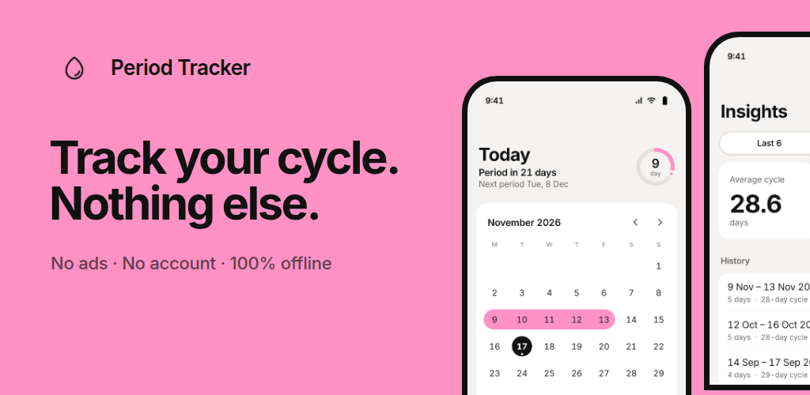
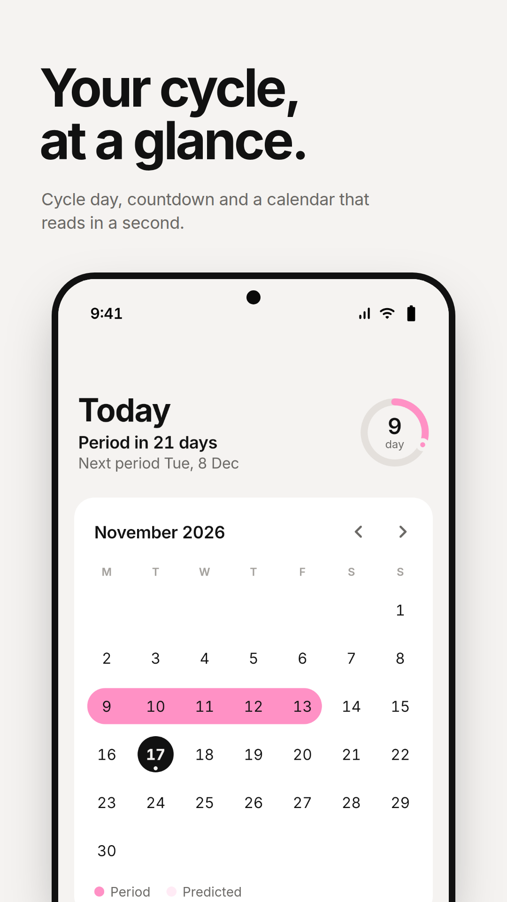
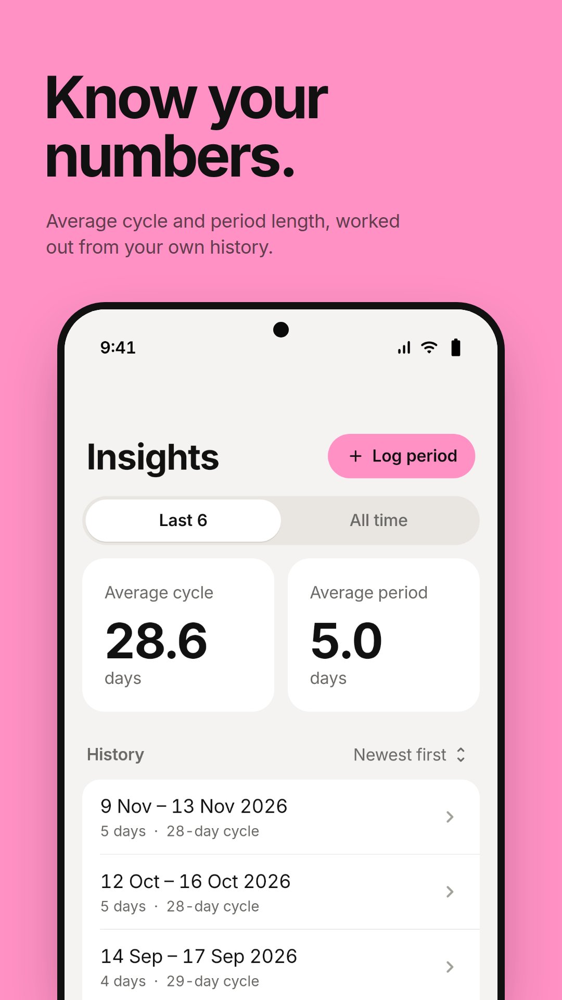
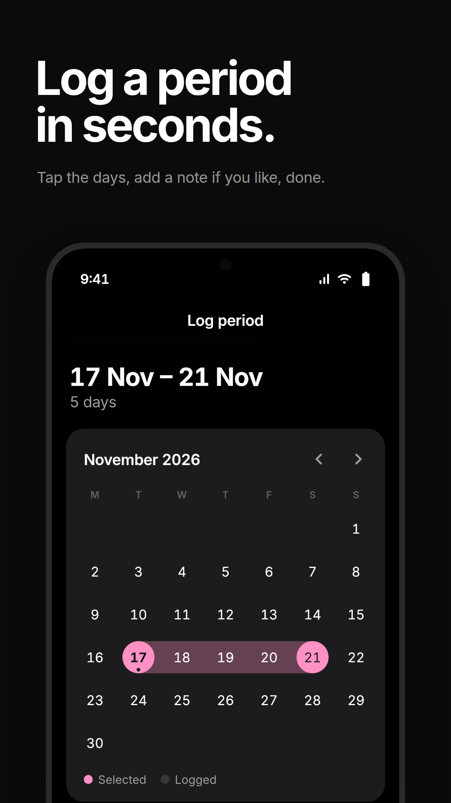
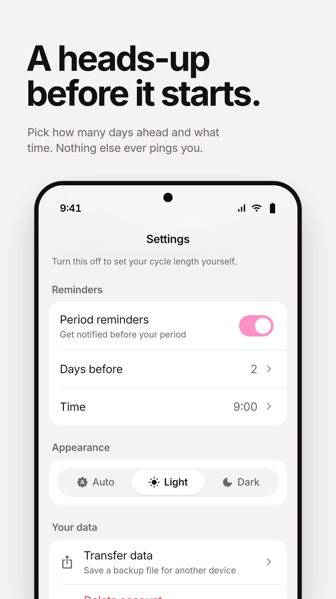
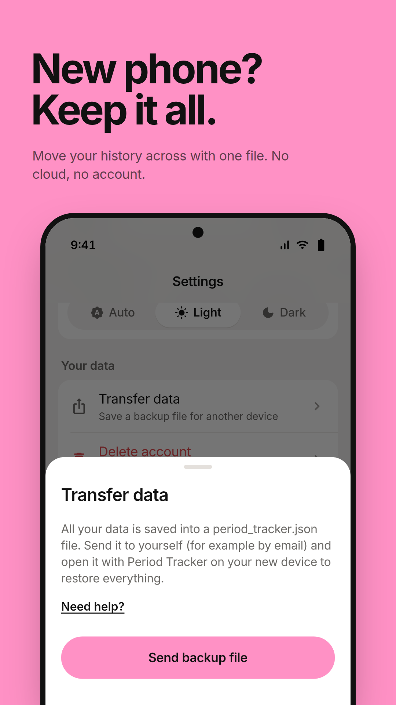

  

<h1>&nbsp;&nbsp;Period Tracker</h1>

**A simple, private period tracker for Android.** No ads, no account, works fully offline, and your data never leaves your phone unless you send feedback.
 
Built for my girlfriend, who just wanted to track her cycle without annoying ads or premium upsells.

  
  &nbsp;
  
   
  
  
  

  
  
  
  
  

  <i>Available on Google Play Store and as a direct APK download. Not available on App Store because because fuck Apple and their $99/year membership</i>

## Features
- **Quick logging** - log a period in a couple of taps with a clean, simple calendar
- **Insights** - average cycle length, average period length and your full history
- **Smart predictions** - the next period is predicted from your past cycles and adjusts over time
- **Static mode** - prefer fixed numbers? Set your own cycle and period length
- **Reminders** - get notified a chosen number of days before your period starts
- **Offline backup** - move your data to a new phone without any cloud or account
- **Private by design** - no ads, no account, no tracking
- Light and dark theme, and a few easter eggs

## Development
Pull requests are welcome! For major changes, please open an issue first to discuss what you'd like to change.

Period Tracker is built with Flutter. See [CONTRIBUTING.md](CONTRIBUTING.md) for setup, running and testing, code structure, branch and PR naming, and how to release.

## Legal
Your data is stored only on your device. Full privacy policy available at [periodtracker.lan.si](https://periodtracker.lan.si/privacy).

Distributed under the [GNU General Public License v3](/LICENSE).
